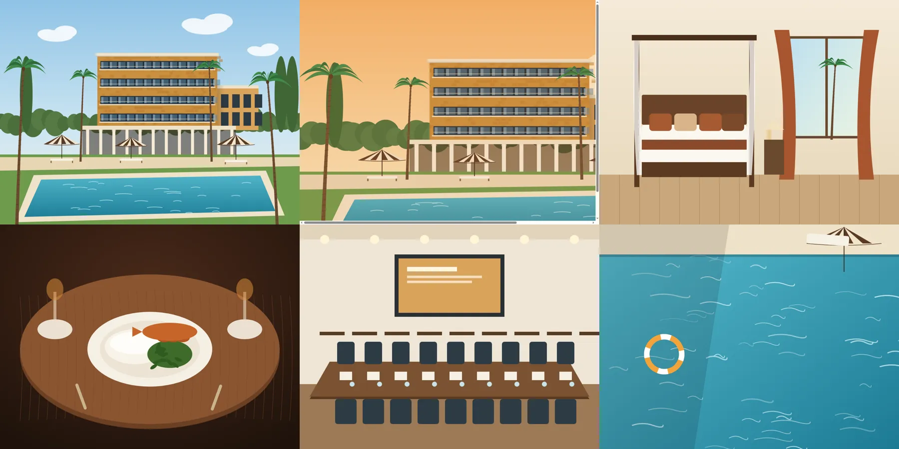

# The Breez Hotel — website

A hospitality website for **The Breez Hotel, Busia, Kenya**: rooms, dining, the pool, conferences and events, and reservation enquiries, designed mobile-first for guests travelling through Busia and the Kenya–Uganda border.

> **Status: research and design stage.** There is no website code in this repository yet. What is here is the project documentation, the design direction and original concept illustrations. Nothing in this repository has been approved by the hotel for publication.



*Original vector illustrations drawn for the design concepts. They stand in for photography until the hotel supplies approved photos, and are not pictures of the actual hotel.*

## Objectives

- Give guests a fast, clear way to see the rooms, pool, restaurant and conference spaces.
- Turn visits into **booking and quotation requests**, by form, phone and WhatsApp.
- Present the hotel honestly: only facilities, prices and policies confirmed by hotel management.
- Load quickly on ordinary phones and slow mobile connections.

## Design direction

Warm and welcoming, polished but true to a mid-range town hotel — not an imitation ultra-luxury resort. The palette comes from the building itself:

| Role | Colour | Hex |
| --- | --- | --- |
| Ground | Warm sand | `#F7F1E6` |
| Primary | Palm green | `#23402F` |
| Accent | Ochre | `#C98A2E` |
| Support | Terracotta | `#A8562F` |
| Detail | Pool blue | `#1F7F98` |

Editorial serif headings with a clean sans-serif body. Three homepage directions are being explored — see [docs/DESIGN_DIRECTION.md](docs/DESIGN_DIRECTION.md).

## Planned pages

| Page | Main content |
| --- | --- |
| Home | Hero, availability request bar, rooms, pool, dining, conferences, gallery, reviews, location |
| Rooms | Room categories, details, galleries, room comparison, enquiry |
| Dining | Restaurant and bar, digital menu with categories |
| Pool | Pool and garden, hours and day-visit information |
| Conferences & events | Meeting rooms, events and celebrations, quotation request |
| Gallery | Filterable photo gallery with lightbox |
| Offers | Packages approved by the hotel |
| About | The hotel's story and setting |
| Contact | Map, directions, phone, WhatsApp, enquiry form |
| FAQ | Booking, check-in, payment, children, parking and more |

## Technology

Planned for the first (frontend) stage: semantic **HTML**, **CSS** and **vanilla JavaScript**, with no framework and no build step, so the site runs on ordinary shared hosting. Booking and quotation forms will work on the page (date checks, number of nights) and be wired to a back end in stage two.

The repository currently contains:

```text
the-breez-hotel/
├── README.md
├── .gitignore
├── design/
│   └── illustrations/      Original SVG concept illustrations
├── docs/
│   ├── PROJECT_OVERVIEW.md
│   ├── DESIGN_DIRECTION.md
│   ├── RESEARCH_NOTES.md
│   ├── ASSETS_AND_LICENSING.md
│   ├── DEPLOYMENT_GUIDE.md
│   └── images/
└── tools/
    └── make_illustrations.py   Regenerates the SVG illustrations
```

`site/` (the website itself) will be added in the build stage.

## Getting started

Requirements: Git and Python 3 (only for the illustration script).

```bash
git clone https://github.com/Baswet/the-breez-hotel.git
cd the-breez-hotel

# Regenerate the concept illustrations into design/illustrations/
python3 tools/make_illustrations.py design/illustrations
```

Once the site exists, it will be previewed with any static server, for example:

```bash
python3 -m http.server 8000 --directory site
```

## Roadmap

1. **Research** — hotel facts, social media, competitors, design references. *Done; findings held privately until the hotel approves them.*
2. **Design** — three homepage concepts, then one chosen direction. *In progress.*
3. **Frontend build** — all pages, responsive layouts, gallery, menu, enquiry forms. *Next.*
4. **Back end** — booking and quotation requests, email and WhatsApp notifications, admin dashboard.
5. **Launch** — only after hotel management approves content, photos and rates.

## Content and assets

- No prices, facilities or policies are published until hotel management confirms them.
- Hotel photographs and the hotel's name are used only with the hotel's permission.
- Third-party assets and their licences are recorded in [docs/ASSETS_AND_LICENSING.md](docs/ASSETS_AND_LICENSING.md).

## Author

Built by [Emmanuel (Baswet)](https://github.com/Baswet).
